<h1 align="center">OAuth Guide</h1>

<p align="center"><strong>How long until your users can connect?</strong><br/>
Setup and approval guides for getting your own OAuth app live with 110+ providers, with the evidence behind every claim, and an agent that researches any other app in about two minutes.</p>

<p align="center"><sub>OAuth Guide (repo and URL: <code>oauth-field-guide</code>)</sub></p>

<p align="center">
  <a href="https://oauth-field-guide.vercel.app"><strong>Live app</strong></a> ·
  <a href="docs/ARCHITECTURE.md">Architecture</a> ·
  <a href="docs/VERIFICATION.md">Verification log</a> ·
  <a href="docs/SECURITY_REVIEW.md">Security review</a> ·
  <a href="https://oauth-field-guide.vercel.app/use">Use in AI assistants &amp; Slack</a>
</p>

<p align="center">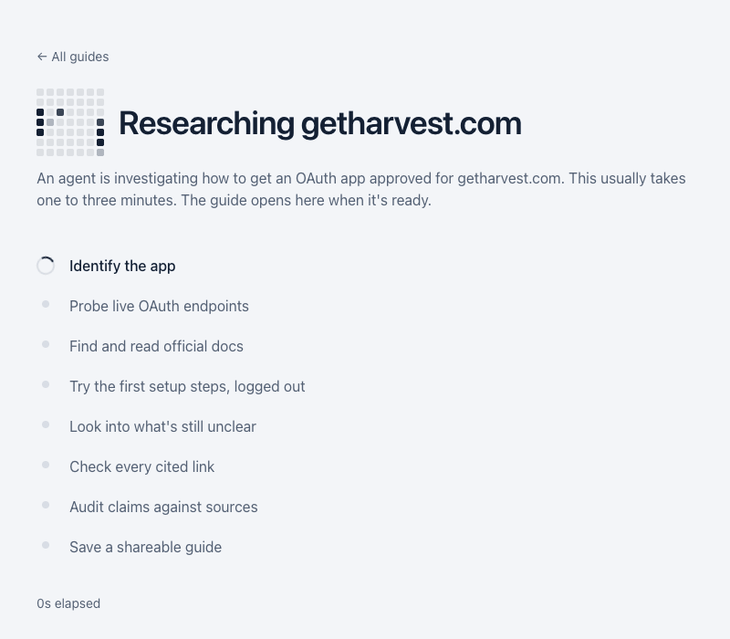</p>

---

## Contents

- [The problem](#the-problem)
- [What OAuth Guide does](#what-oauth-guide-does)
- [Feature tour](#feature-tour)
- [How the agent works](#how-the-agent-works)
- [What the research found](#what-the-research-found)
- [How it maps to the brief](#how-it-maps-to-the-brief)
- [How guides are made, and how we know they're right](#how-guides-are-made-and-how-we-know-theyre-right)
- [Why this matters for Composio](#why-this-matters-for-composio)
- [Key decisions](#key-decisions)
- [Run it locally](#run-it-locally)
- [Limitations and next steps](#limitations-and-next-steps)

## The problem

An AI agent that works in someone's Gmail, Slack or CRM needs an **OAuth app** registered with that provider: a client ID and secret, redirect URLs, and the permissions (scopes) it asks for. Every user who clicks "Allow" creates a **connection** under that one app. Managed OAuth apps get you to a prototype fast, but most teams eventually need their own app: their brand on the consent screen, their own rate limits, scopes the shared app doesn't have.

Registering the app is usually quick. **Getting it approved so anyone can connect is where the surprises are**, and developers usually find out after they've built the integration:

| Provider | Works for you in dev | Any user can connect | What's in between |
|---|---|---|---|
| GitHub | 15–60 min | Same day | Nothing, but org owners may need to approve your app |
| Google (Gmail read) | 30–90 min | **6–10 weeks** | Restricted-scope verification plus an annual third-party security assessment (CASA) |
| Slack (agent that reads messages) | 15–60 min | **1–3 months** | Unlisted apps are throttled to 1 history request a minute; reading at scale realistically needs a Marketplace listing |
| LinkedIn (read data) | 30 min – 2 h | **4–12 weeks**, not guaranteed | Partner-program approval |

The developer's real questions: *How hard is this? How long, including the waiting? What will block me? What can an AI do for me, and what do I have to do myself?*

## What OAuth Guide does

1. **Answers the planning question first.** Every guide opens with two clocks, *working in dev* and *any user can connect*, plus what you're waiting on and what it costs.
2. **Shows its evidence.** Every claim is labelled **Tested**, **Sourced**, **Inferred** or **Unverified**, with numbered sources. "Tested" can only come from checks our own code ran.
3. **Walks you through it.** A step-by-step checklist that says who does each step: *You (Developer)*, *Provider review*, or *AI can help*.
4. **Does the work it can.** The AI assistant drafts the privacy policy, scope justifications and demo script, builds a full review pack, and for Slack and GitHub opens the provider's console with your app pre-filled.
5. **Covers any app.** Not in the library? An agent reads the provider's docs, tries the first setup steps logged out, decides whether to dig deeper, and saves a guide for everyone.
6. **Works where you build.** The same guides are available as an MCP server in Claude, Claude Code, Cursor and VS Code, and as a Slack app.

## Feature tour

### Search 110+ apps, popular first

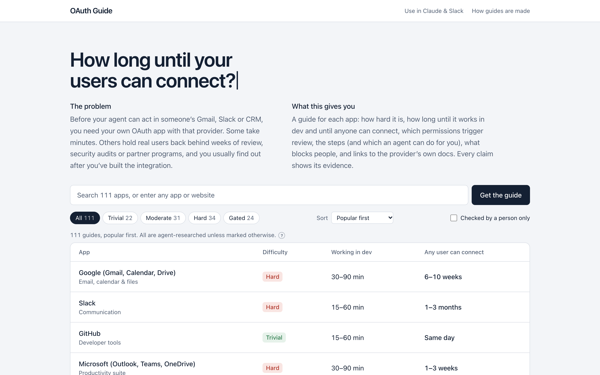

Search by name, category or website; filter by difficulty; sort by popular, hardest or longest to go live. Anything not in the list goes to the live agent.

### The verdict, and how each estimate was made

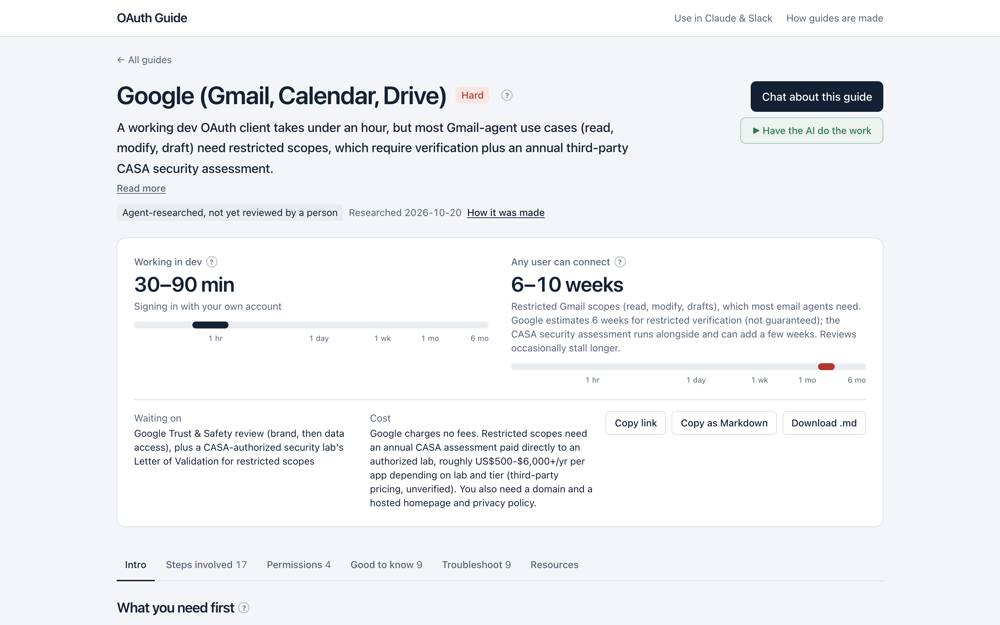

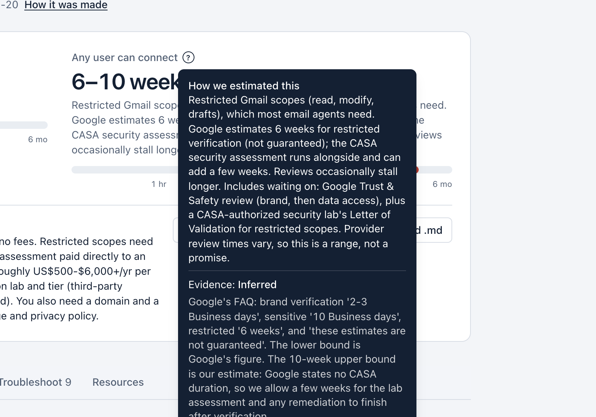

Every "?" opens the reasoning: what the range assumes, what you're waiting on, the evidence label and the source. Here, Google's own FAQ ("6 weeks", "not guaranteed") plus time for the CASA assessment.

### Steps as a checklist, split by who does them

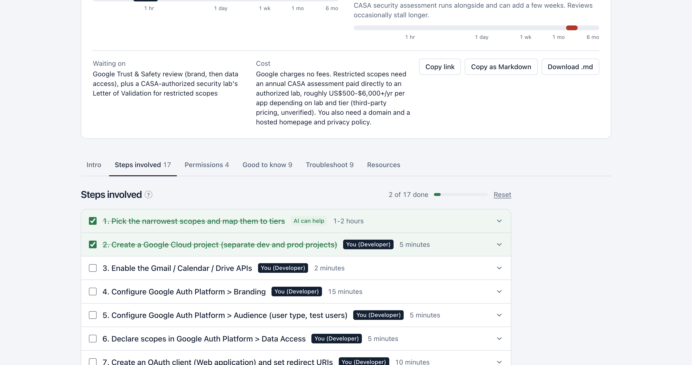

Tick steps off as you go (saved in your browser). Steps marked *AI can help* have **Do it with AI** and **Copy prompt**.

### The AI does the work, and you approve

<p>
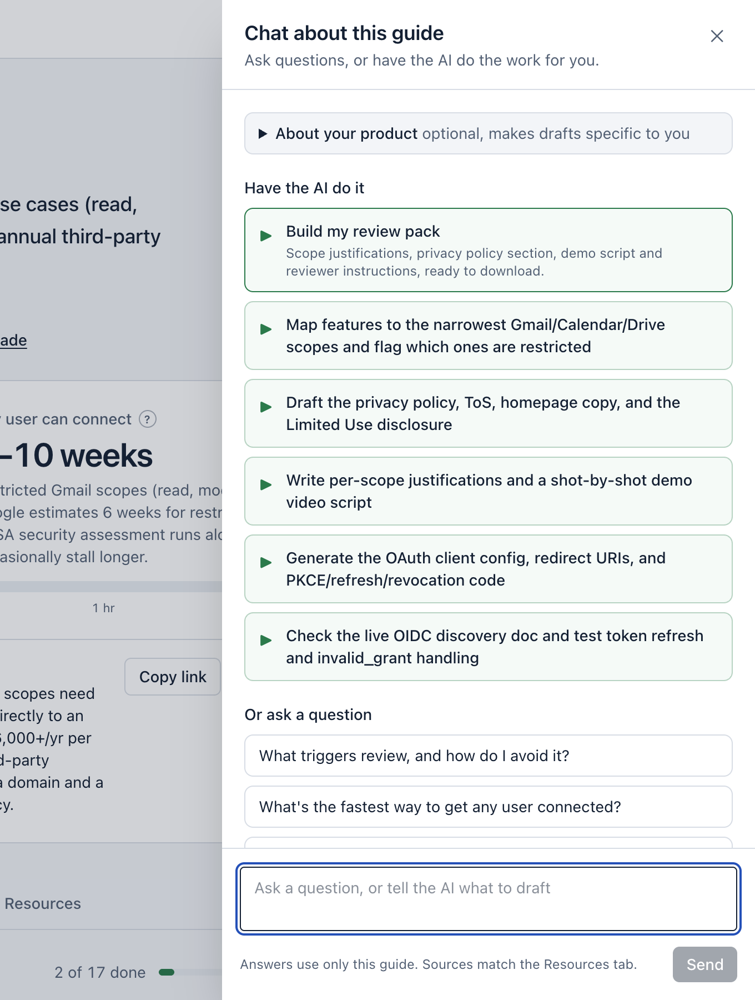
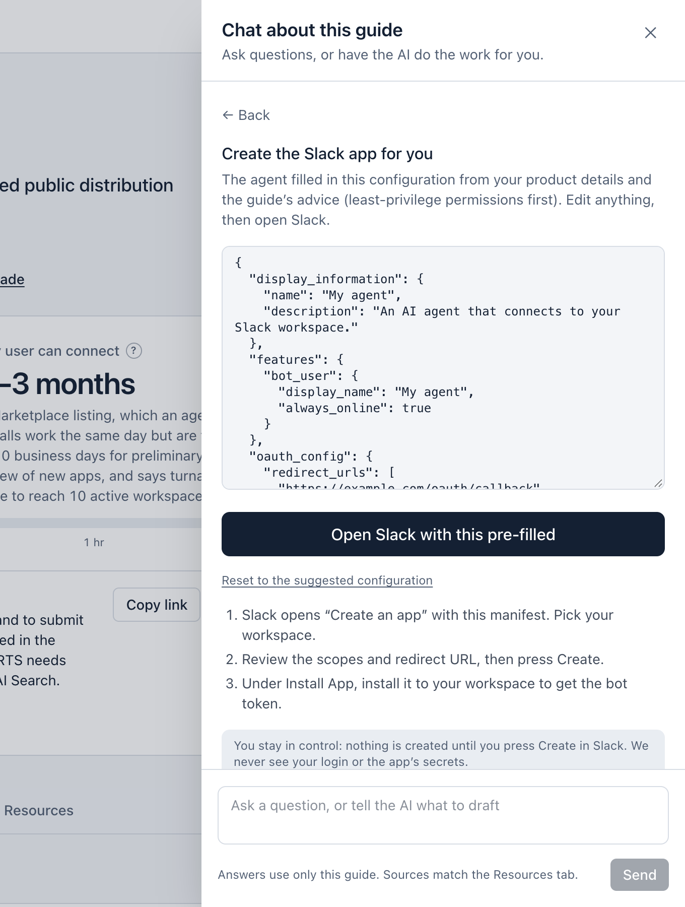
</p>

- **Drafts** for each *AI can help* item: privacy policy and Limited Use disclosure, scope justifications, demo script, OAuth config.
- **Review pack:** everything a provider's reviewers ask for, in one downloadable Markdown file.
- **Create the app for me** (Slack and GitHub): the agent builds the app configuration from your product details and least-privilege advice, then opens the provider's console pre-filled using [Slack's manifest pre-fill](https://docs.slack.dev/app-manifests/configuring-apps-with-app-manifests) and [GitHub's URL parameters](https://docs.github.com/en/apps/sharing-github-apps/registering-a-github-app-using-url-parameters). You press Create; we never see your login or secrets.
- **Chat about this guide:** answers come only from that guide, with sources.

### A live agent for any other app

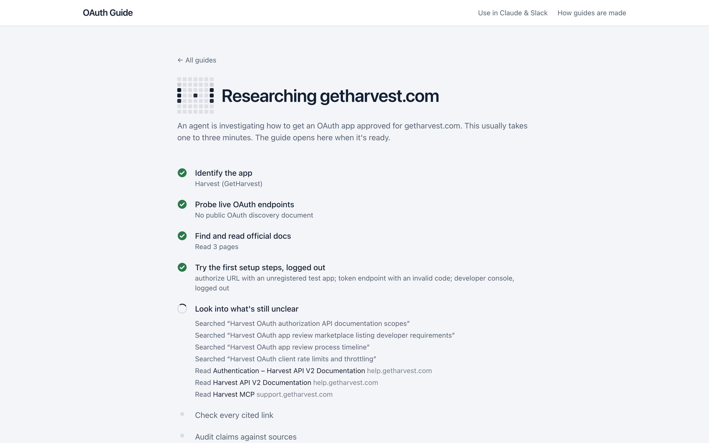

The agent's work is visible as it happens: what it searched, which pages it read, the setup steps it tried, and the questions it decided to dig into.

### How this guide was made

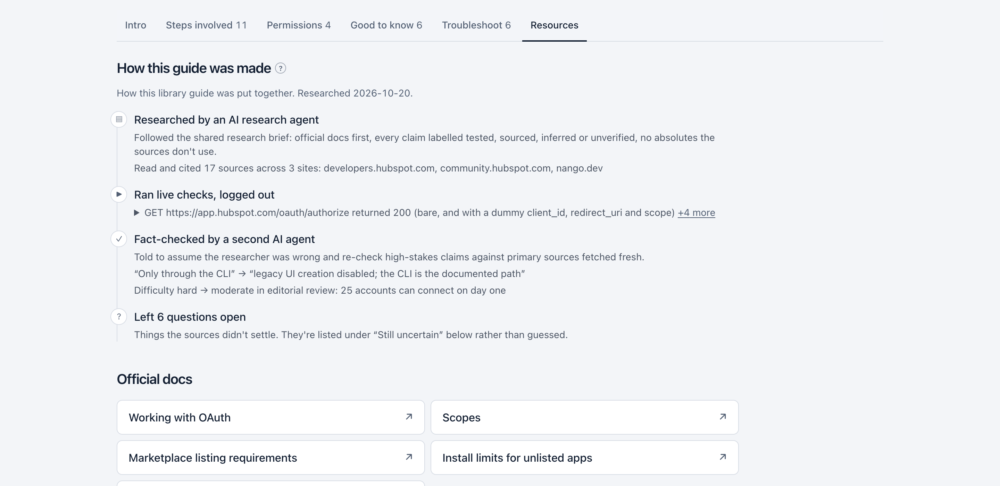

The agent's reasoning doesn't disappear when the run ends. Every guide keeps a timeline of what was read, tried, decided and corrected, and what's still uncertain.

### Use it in any AI assistant, and in Slack

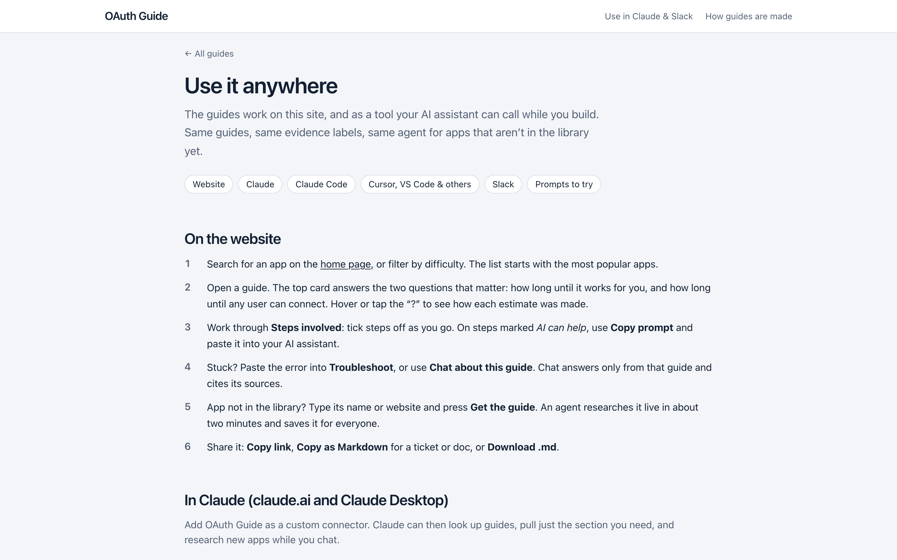

```bash
claude mcp add --transport http oauth-guide https://oauth-field-guide.vercel.app/api/mcp
```

Then ask: *"Using OAuth Guide, compare Gmail, Slack and HubSpot: which will take longest before any user can connect?"* In Slack (once installed in your workspace, see [/use](https://oauth-field-guide.vercel.app/use#slack)): `/oauth-guide gmail`, or `@OAuth Guide what blocks a Slack app from reading messages?`

### First visit, phone, and the details

<p>
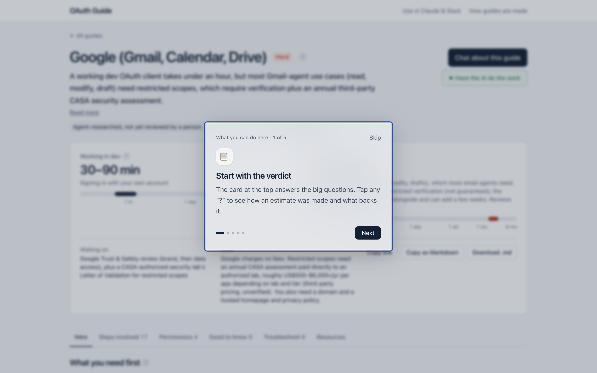
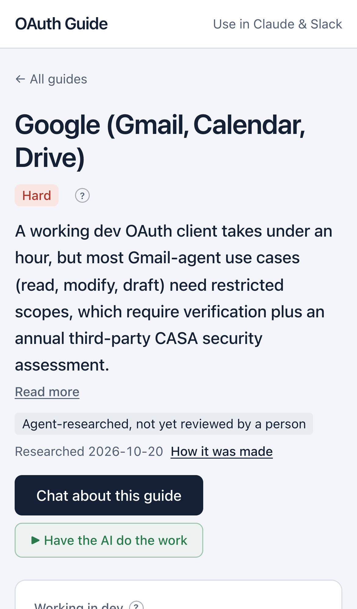
</p>

A short frosted-glass tour on each page's first visit (replay with *Show tips*), tap-to-open help on phones, keyboard support throughout, and a check that nothing overflows on any guide at desktop or phone width.

## How the agent works

A bounded pipeline with **one real decision point**. Our code picks every URL it fetches; the models only read text and write structured output.

| Stage | Input | Tools and model | Output, and what gets rejected |
|---|---|---|---|
| Identify | App name or website | gpt-5-nano (structured) | Canonical name and site. **Rejects** non-apps, prompt-injection input, apps with no third-party OAuth |
| Probe | Provider domain | Our code: OIDC / OAuth discovery URLs | Endpoints, PKCE support (only if on the provider's domain) |
| Read | Name, domain | Firecrawl search, our filters | Up to 8 pages: provider's own domain first, allowlisted doc sites only |
| Write | Those pages | gpt-5-mini (Zod schema) | Draft guide citing page ids; sources set by code, so URLs can't be invented |
| Try | Draft's endpoints | Our code: authorize URL with a test app, token endpoint with a bad code, console logged out | Status, redirect host, OAuth error code (never raw response text) |
| **Decide** | Open questions | gpt-5-nano | **Whether** to run up to 2 more searches, which questions, and why |
| Revise | New pages and checks | gpt-5-mini | Updated guide |
| Audit | Final guide | Our code + gpt-5-nano | Model "tested" labels removed; Tested notes added only from our checks; dead links downgrade claims; **rejects** guides describing OAuth in the wrong direction |

Every stage is recorded and saved with the guide ("How this guide was made"). Full diagrams: [ARCHITECTURE.md](docs/ARCHITECTURE.md).

**Limits:** live research 10/hour and 25/day per network, 40/day overall; chat 20/hour and 100/day per network; at most $0.20/day of spend per network (IPv6 counted per /64); $0.60/day and $1.80 lifetime spend caps, with $0.10 of each day kept for chat. **MCP tools:** `search_guides`, `get_guide` (any section), `generate_guide` (starts live research in the background; same limits). **Slack:** built and tested with Slack-signed requests; not yet installed in a public workspace (setup on [/use](https://oauth-field-guide.vercel.app/use#slack)).

## What the research found

The research agents turned up things a typical setup checklist misses:

- **Slack:** since 2025, new commercially distributed apps outside the Marketplace get **1 `conversations.history` request a minute, 15 messages per call**, and can't use the Real-time Search API or Slack's MCP server.
- **Gmail:** even creating drafts (`gmail.compose`) is a **restricted** scope, so it needs the security assessment, not just review.
- **Microsoft 365:** in many work tenants, users can't consent to mail or calendar access themselves; **an admin in each customer tenant** has to.
- **Zendesk:** developer terms now **ban using a customer's API token or own OAuth client**; partners need a global OAuth client and Marketplace review.
- **Strava and Oura:** API terms restrict **using their data with third-party AI**; Spotify development mode is capped at 5 users.
- **Dropbox:** **new linking freezes** two weeks after 50 users unless the app has production approval.
- **A new fast path:** Evernote, Basecamp, GitLab, DigitalOcean and Close now run **MCP servers with dynamic client registration**, which skip app registration entirely for MCP-capable agents.
- **No OAuth at all:** agents declined to write guides for **Freshdesk** and **Jotform**, whose APIs only offer keys to third parties.

## How it maps to the brief

| The brief asks for | Where it is |
|---|---|
| How easy or hard it is | Difficulty rating on every guide (trivial · moderate · hard · gated) with the scale explained |
| Time and effort, including approval waits | Two clocks per guide, *assumes* and *waiting on*, a time per permission tier, and cost |
| Requirements and nuances | *What you need first*, *Permissions*, *Good to know* (grouped by topic), *Troubleshoot* with error search |
| What an agent can do vs. where you take over | *Who does what*, owner tags on every step, *Do it with AI*, review pack, pre-filled app creation |
| Agents investigate and attempt setup | Live agent: probe, read, **try the first setup steps logged out**, decide whether to dig deeper, audit |
| A library of guides | 110 agent-researched guides across trivial to gated |
| Submit any app, get a shareable guide live | Search box → live research → permalink; also via MCP and Slack |
| Clear about tested vs sourced vs uncertain | Evidence label on every claim, research trail, "Still uncertain" list |
| Check a sample against real sources | Independent fact-check, timeline audit, hands-on checks ([VERIFICATION.md](docs/VERIFICATION.md)) |
| Useful without explanation, shareable | Copy link, Copy as Markdown, Download .md, first-visit tours |

## How guides are made, and how we know they're right

| Layer | What happened | Result |
|---|---|---|
| Research | 26 research agent runs (6 for the first guides, then 20 batches) followed one [research brief](docs/RESEARCH_BRIEF.md): official docs first, every claim labelled, no invented URLs | 110 guides |
| Independent fact-check | A second agent, told to assume the researchers were wrong, re-checked 12 high-stakes claims against primary sources | 11 confirmed, 1 corrected (plus 5 wording or label refinements), no wrong numbers |
| Editorial review | Ratings and wording checked against our own definitions | e.g. HubSpot hard → moderate |
| Timeline audit | 27 guides (the top 25 plus Google and Fitbit) checked against providers' official timelines; tail risk moved out of headline ranges | 9 ranges corrected, 1 wording change, 17 confirmed (Google: 6 weeks – 4+ months → 6–10 weeks) |
| Live agent testing | Real production runs, compared before and after each change | Sources went from 5 of 7 noise to all official; wrong-direction guides now rejected |
| Hands-on | A person sets up GitHub and Google apps with free accounts | **In progress.** Checklist in [HANDS_ON.md](docs/HANDS_ON.md); results go into [VERIFICATION.md §3](docs/VERIFICATION.md) |

Full details: [VERIFICATION.md](docs/VERIFICATION.md), [verification-desk.md](docs/verification-desk.md), [timing-audit.md](docs/timing-audit.md).

**Cost, measured from the spend ledger:** **$0.014–0.025 per live guide** and **$0.0003–0.0016 per chat answer**, under a hard **$1.80** lifetime cap and a **$0.60** daily cap. Total spent building, testing and demoing so far: **$0.08**.

## Why this matters for Composio

This is a prototype of the **research stage of a toolkit onboarding playbook**:

- **Triage by difficulty:** trivial and moderate apps go to an automated fast lane; hard and gated apps get a human owner on day one.
- **Start the long poles first:** partner programs (Gong, LinkedIn, Rippling) and security reviews (Google CASA) are where the calendar time goes. The guides flag them before anyone builds.
- **Approval waits as a pipeline metric:** "any user can connect" becomes an expected-date field per toolkit; days-in-review and overruns are trackable.
- **Agent first, human where it counts:** agents identify, probe, read, try, audit and draft; people own provider accounts, legal pages, submissions and final QA. *Who does what* is exactly that split.
- **Supply and health:** toolkits live, share with a human-verified guide, median time to production by tier, broken-link and stale-claim rate from scheduled re-runs.

### Week 1 at Composio

1. Run the agent across the current toolkit list to rate each toolkit's difficulty and two clocks, and compare with known pain points from the toolkit engineers.
2. Pull the Hard and Gated toolkits on the roadmap forward: start their partner-program and security-review applications first, because approval, not engineering, sets the date.
3. Propose 4 supply and health metrics (toolkits live, % with a human-verified guide, days in review, stale-claim rate from scheduled re-runs) and where they're tracked.
4. Hand-verify a sample of guides with the toolkit engineers and publish the correction rate, so everyone knows how far to trust agent output.
5. Write the first SOP: the agent researches and drafts, a person checks the gated steps and owns submissions, QA signs off before launch.

## Key decisions

- **Two clocks, not one number.** The gap between "works in dev" and "any user can connect" is the surprise developers hit.
- **"Tested" only from code.** The model can't award the strongest evidence label; only our own live checks can.
- **A bounded agent with one real decision**, not an open-ended one: predictable cost (≈ $0.02) and time (≈ 2 min) within a $2 budget that hard-stops at $1.80.
- **Our code picks every URL; models only read and write.** This removes the main prompt-injection and SSRF paths.
- **The agent acts through drafts and pre-filled consoles,** never with the user's credentials.
- **Breadth from agents, trust from labels.** 110 guides, clearly labelled agent-researched, with a verified sample showing how accurate they are.

More in [ARCHITECTURE.md → Design decisions](docs/ARCHITECTURE.md#design-decisions).

## Run it locally

**Requirements:** Node 20+, a Neon (or any Postgres) database. OpenAI and Firecrawl keys are only needed for live research and chat; the library works without them.

```bash
git clone https://github.com/Hbandla0305/oauth-field-guide.git
cd oauth-field-guide
npm install
cp .env.example .env.local      # fill in the values below
npm run db:setup                # creates the guides and runs tables
npm run dev                     # http://localhost:3000
```

| Variable | Needed for |
|---|---|
| `DATABASE_URL` | Live guides, spend ledger, rate limits |
| `OPENAI_API_KEY` | Live research and chat (use a dedicated project with a budget) |
| `FIRECRAWL_API_KEY` | Reading docs pages (falls back to OpenAI web search without it) |
| `IP_HASH_SALT` | Rate limiting (required in production) |
| `SLACK_BOT_TOKEN`, `SLACK_SIGNING_SECRET` | Optional Slack app |
| `GENERATION_ENABLED=false` | Kill switch for live research and chat |

**Useful scripts**

| Command | Does |
|---|---|
| `npm run validate` | Validate every guide against the schema and its sources |
| `npm run check-links` | Check cited links; downgrade claims whose sources no longer resolve |
| `npm run spend` / `npm run runs` | Spend ledger and recent live runs |
| `npm run inspect -- <slug>` | Inspect a live-generated guide |
| `npm run try-attempts -- <authorize> <token> <console>` | Run the logged-out setup checks against a provider |
| `npm run slack-test -- <url> "<text>"` | Send Slack-signed test requests |
| `npm run create-runtime-role` | Create a least-privilege database role for the app |

**Deploy:** push to `main` and Vercel builds automatically; every PR gets a preview link.

## Limitations and next steps

- **Human verification is the open gap.** All 110 guides are agent-researched. Hands-on checks of GitHub and Google and desk reviews ([`docs/human-review/`](docs/human-review/)) are in progress; a guide is only marked "Checked by a person" after a person fills in its review sheet.
- **Live guides are listed immediately.** They're labelled "Written live by an agent, not reviewed by a person". A review queue before listing would be the next step at scale.
- **The timeline audit covered the 25 most popular guides.** The rest use the same evidence rules but haven't had a second timing pass.
- **Provider rules change.** Next: a scheduled re-check that re-runs the agent on each guide, diffs the result and flags what changed.
- **Shared rate limits on MCP and Slack.** Limits are per network or workspace, so many Claude users share Anthropic's network; per-user keys would fix this at scale.
- **The Slack app is built and tested with signed requests,** but needs a workspace install to be live.
- **Popular-first ordering is a stated heuristic** (apps featured on composio.dev, then common agent integrations), not usage data.

---

<p align="center">Built by Hrudvi for Composio's APM, Toolkits take-home. Next.js 15 · Vercel · Neon · OpenAI · Firecrawl.</p>
