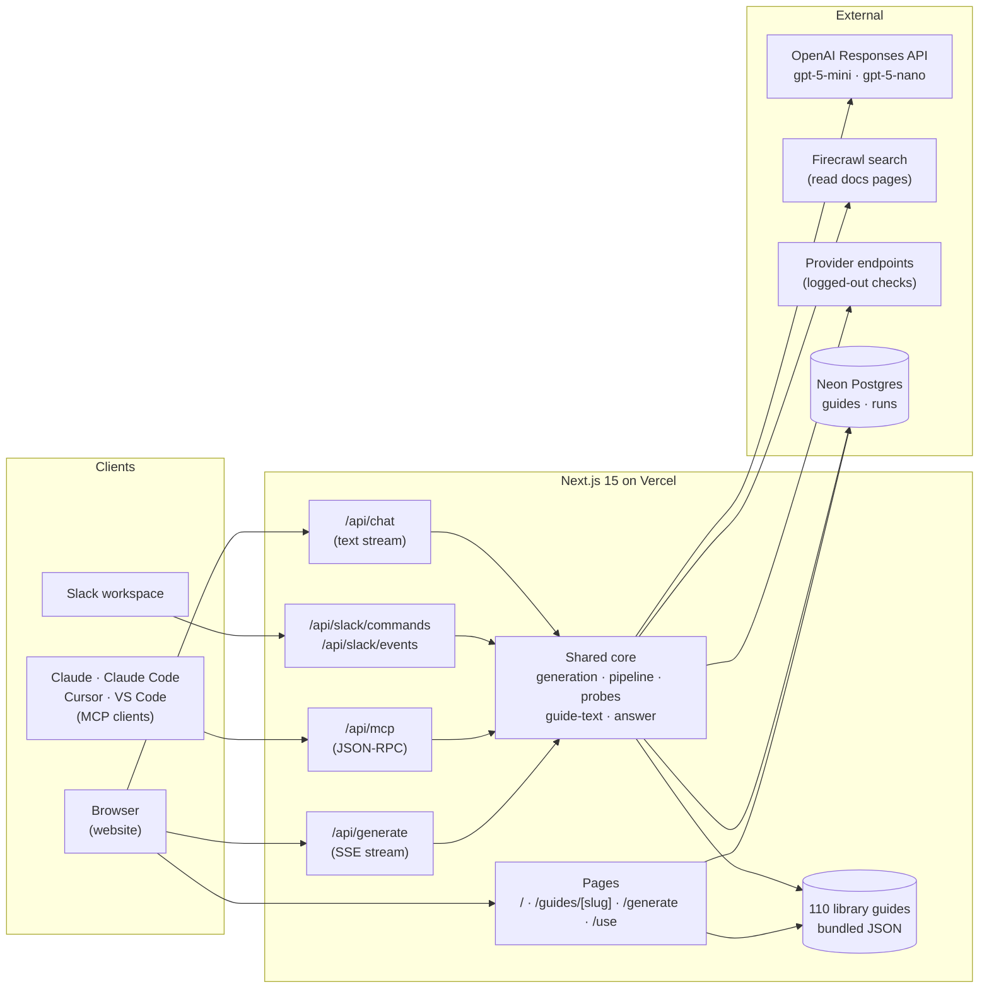
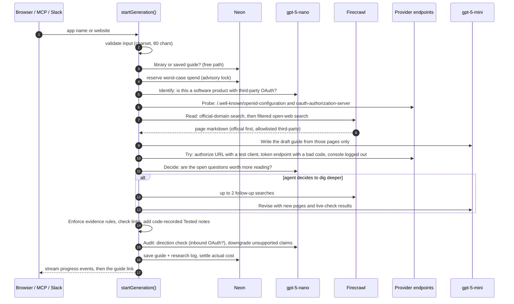
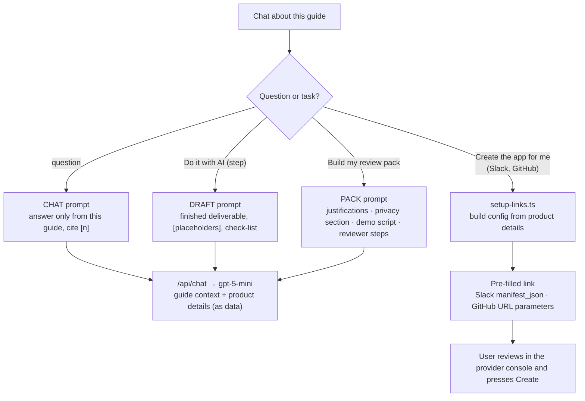
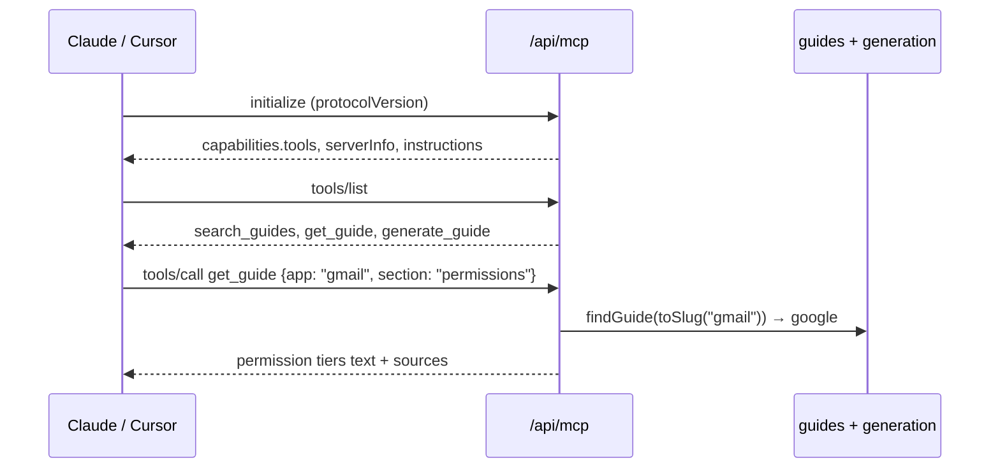
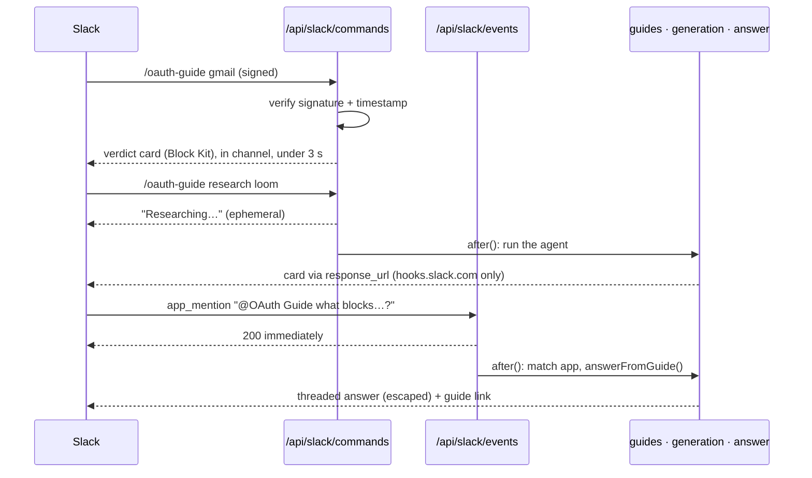
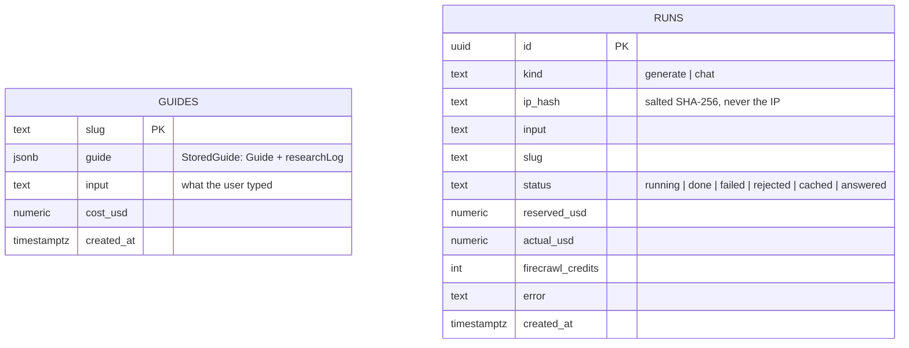
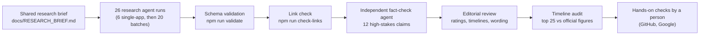

# Architecture

How OAuth Guide works: the systems involved, every endpoint, how data flows between them, and the guardrails around cost, evidence and security.

**Contents:** [System overview](#system-overview) · [Endpoints](#endpoints) · [Live research agent](#live-research-agent) · [Chat and the AI assistant](#chat-and-the-ai-assistant) · [MCP server](#mcp-server) · [Slack app](#slack-app) · [Data model](#data-model) · [Evidence model](#evidence-model) · [Guardrails](#cost-and-abuse-guardrails) · [Security](#security) · [How the library was built](#how-the-library-was-built) · [Code map](#code-map) · [Design decisions](#design-decisions)

---

## System overview



- **Library guides** (110) are JSON files in `src/data/guides/`, validated against a Zod schema and bundled at build time. Reading them costs nothing.
- **Live guides** are written by the agent on request and stored in Neon. They're served from the same routes and are clearly labelled.
- **One shared core** serves every surface (website, MCP, Slack), so the same validation, spend ledger and evidence rules apply everywhere.

## Endpoints

| Endpoint | Method | Used by | What it does | Auth / guard |
|---|---|---|---|---|
| `/` | GET | Browser | Search, filter and sort the library (popular first) | Public |
| `/guides/[slug]` | GET | Browser | One guide: verdict, tabs, checklist, research trail. Library pages are static; live guides render on demand from Neon | Public |
| `/generate?app=` | GET | Browser | Live research screen; streams the agent's progress | Auto-starts only from our own pages, otherwise asks for a click |
| `/use` | GET | Browser | Setup guides for Claude, Claude Code, Cursor, VS Code and Slack, with prompts | Public |
| `/api/generate` | POST | Website | Starts live research. Returns `{slug, cached}` for library hits, otherwise a Server-Sent Events stream of `stage`, `search`, `read`, `done` and `error` events | Same-site JSON only; spend ledger; per-IP and daily caps |
| `/api/chat` | POST | Website | Answers questions, or performs a task (`draft`, `pack`) using one guide and optional product details. Streams text | Same-site JSON only; spend ledger; per-IP caps |
| `/api/mcp` | POST | MCP clients | Stateless MCP (Streamable HTTP, JSON responses): `initialize`, `ping`, `tools/list`, `tools/call` | Public, no auth; batch ≤ 10; research rate-limited per IP |
| `/api/slack/commands` | POST | Slack | `/oauth-guide <app> [section]` · `research <app>` · `help` | Slack signing secret (HMAC-SHA256, 5-minute window) |
| `/api/slack/events` | POST | Slack | `app_mention` answers in a thread; URL verification | Slack signing secret; retries ignored |

**MCP tools**

| Tool | Input | Returns |
|---|---|---|
| `search_guides` | `query?`, `difficulty?`, `limit?` | Matching apps with difficulty and both timelines, popular first |
| `get_guide` | `app`, `section?` (`summary`, `steps`, `permissions`, `good_to_know`, `troubleshoot`, `resources`, `all`) | That section as text, with evidence labels and numbered sources; agent-written guides are prefixed with an untrusted-data notice |
| `generate_guide` | `app` | Library hit: the summary. Otherwise starts research in the background (`after()`) and returns immediately, because many clients time out on multi-minute calls |

## Live research agent

The agent is a bounded pipeline with one real decision point. Our code chooses every URL it fetches; the models only read text and write structured output.



| Step | Who | Output |
|---|---|---|
| Identify | gpt-5-nano, structured output | Canonical name, website, slug, or a plain refusal (not an app, no third-party OAuth, unsafe input) |
| Probe | Our code | OAuth/OIDC discovery metadata if published (endpoints restricted to the provider's domain) |
| Read | Firecrawl, our filters | Up to 8 pages: the provider's own domain first, then allowlisted documentation sites |
| Write | gpt-5-mini, Zod schema | Draft guide citing page ids only; sources are set by our code, so URLs can't be invented |
| Try | Our code | Status code, redirect host and OAuth error code for 3 logged-out checks. Never raw response text |
| Decide | gpt-5-nano | `needMore`, up to 2 questions, and why |
| Revise | gpt-5-mini | Guide updated with the extra pages and checks |
| Enforce | Our code | Model "tested" labels removed, dead links downgrade claims, live checks added as Tested notes |
| Audit | gpt-5-nano | Wrong-direction guides rejected; unsupported claims downgraded (it can only lower confidence) |

Every step is recorded by a `Recorder` and saved with the guide as `researchLog`, so the "How this guide was made" timeline shows what the agent actually read, tried and decided.

## Chat and the AI assistant



- The guide is loaded on the server by slug, so a visitor can't swap in different context.
- Product details (name, website, redirect URL, what the agent does) are saved in the browser and sent as data, not instructions.
- "Create the app for me" never touches credentials. It opens the provider's own console with the configuration filled in, and the user presses Create.

## MCP server

`/api/mcp` implements the stateless subset of MCP over Streamable HTTP: JSON-RPC requests in, JSON responses out, notifications acknowledged with `202`. No SDK is needed for four methods, and it's verified with the official `@modelcontextprotocol/sdk` client.



## Slack app



## Data model

**Neon Postgres**



`runs` is both the spend ledger and the rate-limit table. Spend is `sum(coalesce(actual_usd, reserved_usd))`, so in-flight and crashed runs count at their full reservation.

**Guide document** (`src/lib/guide-schema.ts`, Zod)

| Field | Purpose |
|---|---|
| `app` | name, slug, website, developer portal, category |
| `officialDocs[]` | quick links: oauth, scopes, review, console, api, changelog |
| `verdict` | difficulty, summary, `timeToDev` and `timeToProd` (range, hours, assumes, waitingOn, evidence), cost |
| `prerequisites[]`, `scopeTiers[]`, `steps[]`, `blockers[]`, `nuances[]` | the guide body; every item carries `evidence` |
| `steps[].owner` | `agent` (AI can help) · `human` (You, the developer) · `wait` (provider review) |
| `sources[]` | numbered sources every claim cites |
| `verification` | status (human-verified · agent-researched · agent-generated), dates, tested checks, open questions, corrections |
| `researchLog[]` | (stored guides only) what the agent did, recorded by code; never part of the model's output schema |

## Evidence model

Every claim carries `{label, sourceIds, note}`.

| Label | Meaning | Who can set it |
|---|---|---|
| **Tested** | Observed directly by a live check | **Only our code** (probe and attempt notes). Model-set "tested" is always downgraded |
| **Sourced** | Stated in a cited source | Model, only with at least one reachable source; otherwise downgraded to unverified |
| **Inferred** | Reasoned from sources | Model or audit |
| **Unverified** | Not confirmed, or sources conflict | Model or audit |

The audit can only lower a label, never raise it.

## Cost and abuse guardrails

All numbers live in `src/lib/agent/config.ts`.

| Guard | Value |
|---|---|
| Lifetime budget | $1.80 (under the $2 ceiling) |
| Daily budget | $0.60 |
| Reservation per research run | $0.20, settled to actual cost (≈ $0.02–0.03 in practice) |
| Reservation per chat message or task | $0.02, settled to actual |
| Research rate limits | 10 per hour and 25 per day per network; 40 per day overall |
| Chat rate limits | 20 per hour and 100 per day per network; 300 per day overall |
| Per-run ceilings | output tokens per call; 2 extra searches; 8 + 4 pages; 4-minute timeout |
| Firecrawl | 400 credits total, 30 reserved per run |
| Free paths | library and saved guides never call a model |

Reservations happen in one SQL statement under `pg_advisory_xact_lock`, so concurrent requests can't both squeeze under a cap. Failures are charged their known cost (min $0.02); only a timeout, which can hide unseen spend, keeps the full reservation.

## Security

Summary of `docs/SECURITY_REVIEW.md` (independent review, all findings fixed):

- **No secrets in the repo or git history.** Keys live in Vercel environment variables (`OPENAI_API_KEY`, `FIRECRAWL_API_KEY`, `DATABASE_URL`, `IP_HASH_SALT`, `SLACK_*`).
- **SSRF:** one network layer (`probes.ts`) for every fetch our code makes. https and port 443 only, no IP literals or credentials, manual redirects re-checked per hop, and an undici dispatcher that validates the exact address the socket connects to (`ipaddr.js` unicast only), which closes DNS rebinding. Live checks must stay on the provider's domain.
- **Prompt injection:** models have no tools that act; web pages and check results are fenced as untrusted data; sources and "Tested" come from code; links are https-only at write and render time; Slack output is escaped; MCP output for agent-written guides carries an untrusted-data notice.
- **Web:** CSP, `frame-ancestors 'none'`, nosniff, HSTS, strict referrer policy; same-site JSON required on paid endpoints.
- **Database:** every query is a parameterised tagged template. A least-privilege runtime role is scripted (`npm run create-runtime-role`).

## How the library was built



Agents declined to write guides for apps without third-party OAuth (Freshdesk, Jotform) rather than invent them.

## Code map

```
src/
  app/
    page.tsx                  home: problem, search, popular-first library
    guides/[slug]/page.tsx    guide page (static for library, on-demand for live guides)
    generate/                 live research screen (SSE client, loader, tips)
    use/page.tsx              setup guides for Claude, Claude Code, Cursor, VS Code, Slack
    api/generate              live research (SSE)
    api/chat                  questions and tasks (streamed)
    api/mcp                   MCP server
    api/slack/{commands,events}
  components/
    guide/guide-view.tsx      tabs, verdict, checklist, who-does-what
    guide/chat-panel.tsx      assistant: actions, product details, app setup
    guide/research-trail.tsx  "How this guide was made"
    guide-search.tsx          library search, filters, sorting
    info-tip.tsx, evidence.tsx, page-tour.tsx, typewriter.tsx, dot-loader.tsx
  lib/
    agent/pipeline.ts         the research agent (identify → … → audit) + Recorder
    agent/probes.ts           hardened fetch, discovery probe, live setup checks
    agent/firecrawl.ts        docs search and filtering
    agent/prompts.ts          every prompt
    agent/config.ts           models, prices, limits
    generation.ts             shared entry point + guardrails for all surfaces
    db.ts                     Neon: guides, spend ledger, rate limits
    guide-schema.ts           Zod schema (Guide, StoredGuide, ResearchLog)
    guides.ts, guide-text.ts, markdown.ts, research-trail.ts, setup-links.ts, slack.ts, answer.ts
  data/guides/*.json          the library
scripts/                      validate, link check, spend ledger, inspect/export runs, security tests
docs/                         plan, research notes, verification, security review, timing audit, screenshots
```

## Design decisions

| Decision | Why | Trade-off |
|---|---|---|
| Two clocks: "working in dev" vs "any user can connect" | The gap between them is the surprise developers hit | Needs a stated assumption per guide (`assumes`) |
| Evidence label on every claim, and "Tested" only from code | Provider rules change; trust is the product | More cautious-looking guides |
| Bounded pipeline with one agent decision, not an open-ended agent | Predictable cost (≈ $0.02/run) and latency (≈ 2 min) under a $2 budget | Less exploratory than a free-roaming agent |
| Our code picks every URL; models only read and write | Removes the main prompt-injection and SSRF paths | The agent can't follow links it finds interesting |
| Firecrawl reads pages, OpenAI writes | Grounded in full page text, cheaper than search-tool tokens | Two vendors |
| Library guides as JSON in the repo | Reviewable in PRs, free to serve | Updates need a deploy |
| Agent acts for the user via drafts and pre-filled consoles | Real work without handling credentials or breaking provider terms | The user still presses Create |
| Stateless MCP without an SDK | Four methods; no dependency churn during a major SDK transition | Hand-rolled protocol surface (tested with the official client) |
| Generated guides listed immediately | Owner's request: searched guides are saved for everyone | Labelled "written live by an agent, not reviewed" |
